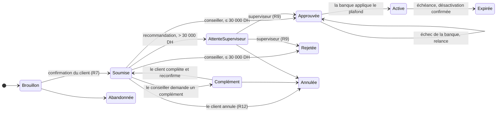
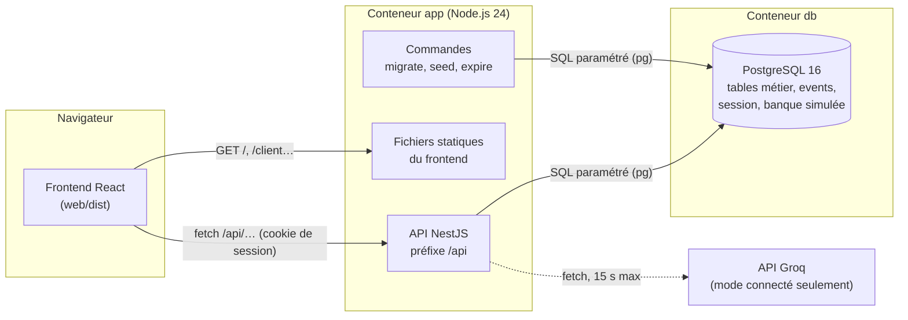
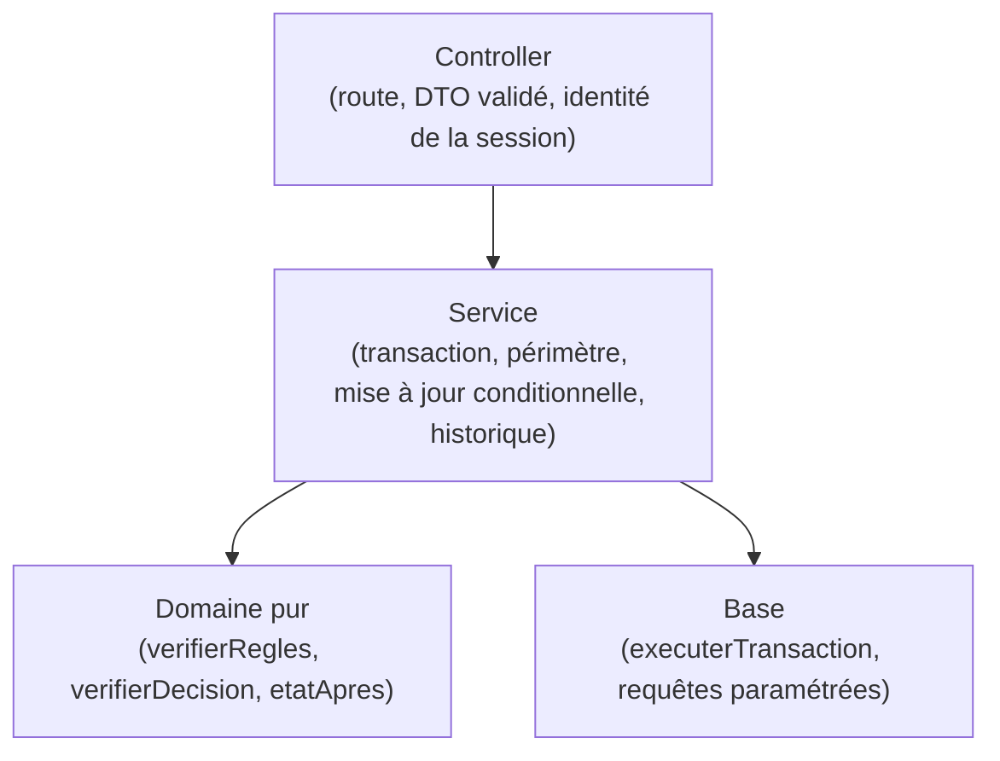
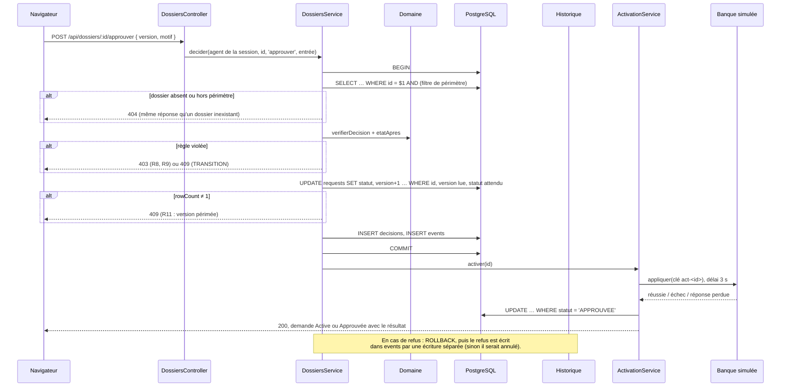
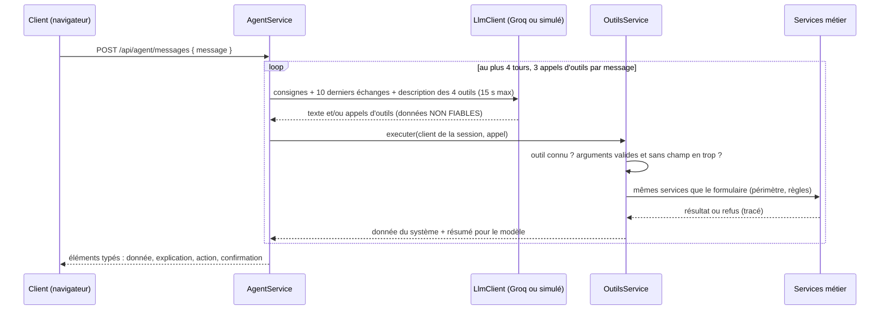

# Présentation du projet

Ce document explique le projet de bout en bout : ce qu'il fait, comment il est construit et pourquoi. Il sert de point d'entrée ; les détails sont dans les documents de référence, cités à chaque section.

| Document | Contenu |
|---|---|
| [etats-transitions.md](etats-transitions.md) | Règles R1 à R14, états, transitions, hypothèses H1 à H23, libellés client, limites connues |
| [modele-donnees.md](modele-donnees.md) | Tables, contraintes, mécanismes de concurrence, migrations, jeu de démonstration |
| [stack-technique.md](stack-technique.md) | Outils retenus et outils volontairement écartés |
| [demonstration.md](demonstration.md) | Lancement et rejeu des 7 scénarios de recette, rôle par rôle |

---

## 1. Le projet en bref

Un client de la banque veut augmenter **temporairement** son plafond de virement, par exemple pour un achat important. Le portail lui permet de :

1. préparer une demande (montant, durée de 1 à 7 jours, motif, justificatif si nécessaire), seul ou avec l'aide d'un **assistant IA** ;
2. la confirmer explicitement, puis la soumettre ;
3. suivre son traitement jusqu'à l'application du plafond par la banque, puis son expiration.

Côté banque, un **conseiller** examine les demandes de son portefeuille. Il décide seul jusqu'à 30 000 DH ; au-delà, il recommande et un **superviseur** de son équipe décide. Une fois la demande approuvée, la banque (simulée) applique le plafond ; à l'échéance, une commande le désactive.

Le projet est un prototype réalisé pour une évaluation technique. Les priorités, dans l'ordre :

1. la cohérence du processus et des règles métier ;
2. la qualité du backend et des données ;
3. la fiabilité des actions de l'IA ;
4. la clarté du parcours.

Le parti pris : **un code simple, lisible et testé**, plutôt qu'un grand nombre de fonctionnalités.

### Trois notions à ne pas confondre

| Notion | Exemple | Où elle vit |
|---|---|---|
| **État métier** | « Approuvée » | `requests.statut` |
| **Décision** | « Approbation par Karim, motif : revenus réguliers » | table `decisions` |
| **Résultat d'exécution** | « La banque n'a pas encore appliqué le plafond » | `requests.activation_statut`, `desactivation_statut` |

Une demande peut être **approuvée** sans que le plafond soit **actif** : c'est le cas quand la banque échoue. L'interface le montre au client (« Décision favorable, plafond pas encore actif ») au lieu de prétendre que tout est fait.

---

## 2. Acteurs et parcours

| Acteur | Ce qu'il fait | Ce qu'il voit (R14) |
|---|---|---|
| Client | Prépare, confirme, soumet, complète ou annule sa demande ; discute avec l'assistant | Ses comptes et ses demandes |
| Conseiller | Demande un complément, approuve ou rejette (≤ 30 000 DH), recommande (> 30 000 DH), relance une activation | Les dossiers de son portefeuille |
| Superviseur | Approuve ou rejette les dossiers recommandés | Les dossiers transmis à son équipe |
| Système | Applique le résultat de la banque ; expire les plafonds à l'échéance | — |
| Assistant IA | Consulte, prépare un brouillon, propose une soumission | Exactement ce que voit le client, rien de plus |

### Cycle de vie d'une demande



Le diagramme complet, les règles R1 à R14 et les 23 hypothèses tranchées (H1 à H23) sont dans [etats-transitions.md](etats-transitions.md).

---

## 3. Architecture générale



Points clés :

- **Une seule application** : l'API NestJS sert aussi le frontend construit. Toutes les routes de l'API sont sous `/api` ; toute autre route `GET` renvoie `index.html`, et React Router prend le relais.
- **Une seule base** : PostgreSQL contient les tables métier, l'historique, les sessions et la banque simulée (`bank_limits`, `bank_operations`). La banque simulée n'a aucune clé étrangère vers les tables métier : le lien passe par une clé d'opération (`act-<id>`), comme avec un vrai système externe.
- **Pas d'ORM** : SQL brut avec le pilote `pg`, requêtes toujours paramétrées.
- **L'IA est derrière une interface** (`LlmClient`) : le mode simulé, déterministe, est utilisé par défaut partout. Le mode connecté appelle l'API Groq par `fetch`.
- **Les commandes** (migrations, jeu de démonstration, expiration) tournent dans des processus séparés, sur le code compilé, et appellent les mêmes services que l'API.

---

## 4. Organisation du code

```
api/
  src/
    domain/        règles et transitions, en TypeScript pur (ni NestJS, ni pg)
    base/          pool pg, fonction de transaction, migrations
    demandes/      controllers et services : client, dossiers, activation, expiration
    auth/          connexion, sessions, guards de rôles
    agent/         LlmClient (Groq, simulé), boucle de l'agent, les quatre outils
    banque/        banque simulée (bank_limits, bank_operations)
    historique/    écriture des événements (table events)
    justificatifs/ contrôle du type de fichier sur ses premiers octets
    http/          format d'erreur unique, validation, en-têtes de sécurité
    demo/          comptes et demandes de démonstration, route du mode de la banque
    commands/      migrer, seed, expirer (scripts lancés en ligne de commande)
    health/        route de santé
  migrations/      001_modele_initial.sql
  test/            tests d'API (base réelle), modèle piégé
web/
  src/
    pages/         écrans client (tableau de bord, formulaire, détail, assistant)
                   et banque (liste des dossiers, détail, mode de la banque)
    api.ts         appels fetch et classe ErreurApi
    session.tsx    contexte React de l'utilisateur connecté
    types.ts       statuts et libellés, recopiés de l'API
    composants.tsx jauge, frise, états, erreurs
    styles.css     feuille de style unique
docker/db/init/    création de la base de test au premier lancement
.github/workflows/ci.yml
Dockerfile, docker-compose.yml
```

---

## 5. Backend

### 5.1 Les couches



- **Controller** : reçoit la requête, valide l'entrée par un DTO (`class-validator`), prend l'identité **dans la session uniquement**, appelle un service. Aucune logique métier.
- **Service** : orchestre l'action dans une transaction. C'est le seul chemin vers les règles : les routes REST, les outils de l'agent et la commande d'expiration appellent les mêmes services.
- **Domaine** (`api/src/domain`) : du TypeScript pur, sans NestJS ni `pg`, donc testable seul.
  - `verifierRegles` contrôle le contenu (R1 à R5, R10) et renvoie **la liste complète des erreurs**, sans lever d'exception. À la soumission, cette liste devient un refus 422 ; sur un brouillon, des avertissements qui ne bloquent rien (H23).
  - `verifierDecision` contrôle les droits de décision (R8, R9, R10).
  - `etatApres` applique la table des transitions, qui porte R12 et R13.
- **Base** (`api/src/base`) : un pool de connexions et `executerTransaction`, qui fait `BEGIN`, `COMMIT` ou `ROLLBACK` et fournit la connexion à utiliser.

### 5.2 Anatomie d'une action

Toutes les actions suivent le même déroulé. Exemple : un conseiller approuve un dossier.



Les cinq principes appliqués partout :

1. **Le périmètre est filtré dans la requête SQL.** Toute action commence par charger le dossier avec ce filtre ; s'il est absent, la réponse est 404. Un dossier hors périmètre ne produit donc jamais un 409 qui révélerait son existence.
2. **Chaque transition est une mise à jour conditionnelle** sur l'identifiant, la version lue et le statut attendu. Si aucune ligne n'est modifiée, la réponse est 409. C'est ce qui garantit R7 (confirmation) et R11 (version périmée), même entre deux requêtes simultanées.
3. **Une seule transaction** pour la transition, la décision, la révision et l'événement. À la première soumission, la référence `DEM-2026-…` est tirée d'une séquence PostgreSQL dans cette même transaction.
4. **Un refus est tracé après l'annulation**, par une écriture séparée, à un seul endroit : le `catch` qui entoure la transaction. Tout ce qui peut refuser l'action (chargement avec le périmètre, règles, mise à jour conditionnelle) est dans ce même `try`.
5. **La date courante est un paramètre** (`maintenant`), jamais un `new Date()` dans le domaine.

### 5.3 Ce qui est garanti par la base

| Garantie | Mécanisme |
|---|---|
| R6 : une seule demande en cours par compte | Index unique partiel `uq_demande_en_cours` ; l'erreur `23505` devient un 409 |
| H1 : un seul brouillon par compte | Index unique partiel `uq_brouillon_unique` |
| R7 : la confirmation porte sur ce que le client a vu | `UPDATE … WHERE version = $ AND plafond_demande = $ AND duree_jours = $` |
| R11 : pas d'action sur une version périmée | `UPDATE … WHERE version = $` ; unicité de `decisions (request_id, request_version)` |
| R14 : périmètre | Filtre dans chaque requête SQL |
| Pas de double activation | Clé fixe `act-<id>`, clé primaire de `bank_operations` |

Ces garanties tiennent sous concurrence. Les tests d'API les vérifient avec deux requêtes réelles lancées en même temps (`Promise.all`) sur une vraie base PostgreSQL.

### 5.4 Format des erreurs

Toutes les erreurs ont la même forme, garantie par un filtre global (`src/http/filtre-erreurs.ts`) :

```json
{ "erreurs": [{ "code": "R4", "champ": "justificatif", "message": "Au-delà de 50 000 DH, un justificatif est obligatoire." }] }
```

| HTTP | Code | Cas |
|---|---|---|
| 400 | `VALIDATION` | Entrée mal formée (type, champ inconnu, champ requis absent) |
| 401 | `AUTH` | Non connecté, identifiants refusés |
| 403 | `R8`, `R9`, `ROLE` | L'acteur n'a pas le droit |
| 404 | `R14`, `INTROUVABLE` | Hors périmètre ou inexistant (même réponse) |
| 409 | `R6`, `R7`, `R11`, `R12`, `R13`, `TRANSITION` | Conflit d'état ou de version |
| 413 | `VALIDATION` | Justificatif de plus de 2 Mo |
| 422 | `R1` à `R5`, `R10` | Contenu invalide ; **toutes** les erreurs à la fois |
| 503 | `IA_INDISPONIBLE` | Modèle indisponible ; les formulaires restent utilisables |
| 500 | `ERREUR_INTERNE` | Erreur inattendue, sans détail technique dans la réponse |

### 5.5 Routes principales

| Route | Acteur | Rôle |
|---|---|---|
| `POST /api/auth/connexion`, `POST /api/auth/deconnexion`, `GET /api/auth/moi` | Tous | Session |
| `GET /api/comptes` | Client | Comptes, plafond appliqué par la banque, demande en cours |
| `POST /api/comptes/:compteId/brouillon` | Client | Crée ou renvoie le brouillon du compte |
| `GET /api/demandes`, `GET /api/demandes/:id` | Client | Liste et détail |
| `PATCH /api/demandes/:id` | Client | Modifie le brouillon (colonnes modifiables listées explicitement) |
| `PUT /api/demandes/:id/justificatif`, `GET …/justificatif` | Client | Dépôt et téléchargement du justificatif |
| `POST /api/demandes/:id/soumettre` | Client | Soumission confirmée (R7) |
| `POST /api/demandes/:id/annuler`, `…/abandonner` | Client | Annulation (R12), abandon du brouillon |
| `GET /api/dossiers`, `GET /api/dossiers/:id` | Conseiller, superviseur | Dossiers du périmètre |
| `POST /api/dossiers/:id/demander-complement`, `…/approuver`, `…/rejeter`, `…/recommander` | Conseiller, superviseur | Décisions motivées |
| `POST /api/dossiers/:id/relancer` | Conseiller, superviseur | Relance d'une activation (H15) |
| `POST /api/agent/messages` | Client | Un message à l'assistant |
| `GET`, `POST /api/demo/banque/mode` | Conseiller, superviseur | Mode de la banque simulée, seulement si `DEMO_MODE=true` |
| `GET /api/health` | — | Santé de l'API et de la base |

---

## 6. Données

Dix tables métier, plus `session` (sessions serveur) et `schema_migrations` (migrations appliquées).

| Groupe | Tables |
|---|---|
| Identités et périmètres | `users`, `teams`, `clients`, `accounts` |
| Demandes | `requests` (copie de travail, état, résultat d'exécution), `request_revisions` (un instantané par soumission : v1, v2…), `decisions` |
| Historique | `events` : acteur, action, date, référence, version, motif, `via_agent`, détails sans secret |
| Banque simulée | `bank_limits` (plafond réellement appliqué), `bank_operations` (opérations déjà traitées, par clé) |

Choix notables :

- **Montants en dirhams entiers** (`integer`) : aucune erreur d'arrondi possible.
- **Rien n'est supprimé** : ni demande (un brouillon abandonné passe à `ABANDONNEE`), ni justificatif (les révisions y font référence).
- **Deux compteurs distincts** : `version`, technique, sert au contrôle de concurrence et n'est jamais affiché ; `revision_no`, métier, est montré à l'utilisateur (H14).
- **Le schéma est créé par des migrations SQL numérotées**, appliquées par `npm run migrate` et enregistrées dans `schema_migrations`.

Le schéma complet, avec diagramme et requêtes, est dans [modele-donnees.md](modele-donnees.md).

---

## 7. Banque simulée, activation et expiration

La banque simulée imite un système externe peu fiable. Son mode (`SUCCES`, `ECHEC`, `REPONSE_PERDUE`) vient de `BANK_MODE`, et peut être changé pendant la démonstration depuis l'écran du conseiller.

- Chaque opération a une **clé fixe** : `act-<id>` pour l'activation, `desact-<id>` pour la désactivation. Une clé déjà connue renvoie toujours son résultat enregistré, quel que soit le mode (H16). Une relance ne peut donc jamais appliquer deux fois le plafond.
- En mode `REPONSE_PERDUE`, la banque applique l'opération mais l'appelant reçoit un délai dépassé. La demande reste « Approuvée » avec un résultat inconnu ; la relance retrouve le résultat d'origine, et la date d'activation est celle de la banque (H17).
- **Un échec tardif n'écrase jamais un succès** : succès et échec sont tous deux conditionnés au statut `APPROUVEE` (ou `ACTIVE` pour la désactivation).
- **Expiration** : `npm run expire -- --date <date>` sélectionne les plafonds échus à cette date simulée et les désactive. Les événements sont datés de l'heure réelle ; la date simulée est enregistrée dans les détails (H22). Une désactivation échouée est reprise au passage suivant.

---

## 8. Agent IA

### 8.1 Principe : le modèle propose, le serveur décide



Le modèle ne fait que **choisir** des outils et rédiger une explication. Tout ce qui compte est exécuté et vérifié par le serveur :

- l'identité vient de la session, jamais du message ni du modèle ;
- les arguments du modèle sont validés comme le corps d'une requête : un champ `statut` ou `version` ajouté est refusé ;
- la version d'un brouillon est relue côté serveur, jamais reçue du modèle ;
- chaque appel d'outil est tracé dans `events` avec `via_agent = true`.

### 8.2 Les quatre outils

| Outil | Ce qu'il fait |
|---|---|
| `consulter_comptes` | Plafond réellement appliqué par la banque, plafond temporaire éventuel, demande en cours du compte (pour prévenir de R6), statut du dossier client (R5) |
| `consulter_dossier` | Liste ou détail des demandes, avec le même filtre que l'écran client : les motifs de recommandation n'y figurent pas (H19) |
| `preparer_brouillon` | Enregistre un brouillon ou un dossier en complément, puis renvoie les avertissements de `verifierRegles` avec leur code. Si un brouillon existe déjà, il le renvoie (H20) |
| `proposer_soumission` | Produit une **carte de confirmation**. Seul le clic du client sur cette carte soumet, par la même route que le formulaire (R7) |

**Aucun outil n'approuve, n'active, ne soumet ni ne modifie des droits.** Un outil inexistant (« approuver ») est refusé et tracé.

### 8.3 Garde-fous

| Garde-fou | Valeur |
|---|---|
| Délai par appel au modèle | 15 s, puis 503 `IA_INDISPONIBLE` |
| Appels d'outils par message | 3 ; au-delà, refusé et tracé |
| Longueur de la réponse | 1 024 tokens |
| Mémoire | 10 derniers échanges, dans la session seulement, avec un résumé des résultats d'outils |
| Justificatifs | Jamais transmis au modèle |
| Affichage | Texte seulement, jamais de HTML (`dangerouslySetInnerHTML` interdit) |

### 8.4 Trois types de messages à l'écran

| Type | Origine | Statut pour le client |
|---|---|---|
| **Donnée du système** | Résultat d'un outil, lu en base | Fait foi |
| **Réponse de l'assistant, à vérifier** | Texte rédigé par le modèle | Peut se tromper ; affiché à part, en pointillés |
| **Action réalisée** | Ce que le système vient de faire (brouillon enregistré) | Fait foi |

S'y ajoute la **carte de confirmation**, que seul le client peut valider.

### 8.5 Trois implémentations de `LlmClient`

| Implémentation | Où | Usage |
|---|---|---|
| Simulée (`llm-simule.ts`) | `src/` | Par défaut partout (`LLM_MODE=mock`). Déterministe, par correspondance de motifs : parcours normal, brouillon de 60 000 DH sans justificatif (avertissement R4), tentative de contournement, accès à un autre compte |
| Connectée (`llm-groq.ts`) | `src/` | `LLM_MODE=connecte` avec `GROQ_API_KEY` ; sans clé, l'API refuse de démarrer |
| **Piégée** (`llm-piege.ts`) | `test/` seulement | Obéit à l'attaquant et appelle les outils avec des arguments malveillants |

Les tests d'attaque utilisent le modèle piégé. Ils couvrent la demande d'approbation directe, le dossier d'un autre client, une version inventée, un champ `statut` ajouté, un outil inexistant et plus de 3 appels d'outils. Chacun vérifie trois choses :

- aucune table métier n'est modifiée ;
- aucune donnée hors périmètre n'apparaît dans la réponse ;
- le refus est tracé dans `events`.

---

## 9. Sécurité

| Sujet | Mesure |
|---|---|
| Mots de passe | Argon2id. Si l'e-mail est inconnu, le mot de passe est quand même vérifié contre un hachage factice : même message et même temps de réponse |
| Session | Cookie `httpOnly`, `SameSite=Strict`, `Secure` si `COOKIE_SECURE=true` ; régénérée à la connexion, détruite à la déconnexion, expirée après 30 min d'inactivité ; stockée dans PostgreSQL |
| Identité et périmètre | Toujours tirés de la session ; périmètre filtré en SQL ; 404 hors périmètre |
| Entrées | `ValidationPipe` global avec `whitelist` et `forbidNonWhitelisted` ; colonnes modifiables listées explicitement |
| SQL | Toujours paramétré, jamais concaténé |
| Justificatif | 2 Mo maximum ; type vérifié sur les premiers octets (PDF, PNG, JPEG) ; enregistré sous un nom généré (uuid) ; téléchargé avec `Content-Disposition: attachment` ; jamais transmis au modèle |
| En-têtes | `X-Content-Type-Options: nosniff`, `Content-Security-Policy: frame-ancestors 'none'`, `Referrer-Policy: same-origin` |
| Secrets | Aucun dans Git ni dans le journal ; l'API refuse de démarrer sans `SESSION_SECRET` |
| Démonstration | Les routes `/api/demo/...` n'existent que si `DEMO_MODE=true` |

---

## 10. Frontend

React 19 et Vite, sans bibliothèque de composants : une feuille de style unique (`styles.css`) et quelques composants partagés (`composants.tsx`).

| Route | Écran |
|---|---|
| `/connexion` | Connexion |
| `/client` | Tableau de bord : plafond appliqué (le « coffre »), jauge des seuils, demande en cours avec sa frise, historique |
| `/client/comptes/:compteId/brouillon` | Formulaire de demande, puis écran « Vérifiez votre demande » (confirmation R7) |
| `/client/demandes/:id` | Détail d'une demande : état, frise, motifs, versions |
| `/client/demandes/:id/completer` | Formulaire en complément demandé |
| `/client/assistant` | Conversation avec l'assistant |
| `/banque` | Dossiers : à traiter, activation à reprendre, autres ; mode de la banque simulée |
| `/banque/dossiers/:id` | Détail d'un dossier et panneau de décision ou de relance |

Principes :

- **L'écran ne décide de rien.** Les rôles orientent l'affichage, mais chaque route de l'API contrôle elle-même les droits. Un bouton absent n'est jamais la seule protection.
- **Les libellés d'état** viennent de [etats-transitions.md](etats-transitions.md) § 6, recopiés dans `types.ts`.
- **La jauge** situe le plafond appliqué et le plafond demandé parmi les seuils : 10 000 DH (habituel), 30 000 DH (superviseur), 50 000 DH (justificatif) et 100 000 DH (maximum).
- **La frise** n'affiche que des données fournies par l'API (statut et dates).
- **La version technique** est transmise par les formulaires sans être affichée ; seule la révision (v1, v2…) est montrée.
- **Une session expirée** (401) renvoie vers la connexion.
- **Accessibilité** : focus clavier visible, animations désactivées si le système le demande, mise en page jusqu'à 390 px de large.

En développement, Vite (port 5173) redirige `/api` vers l'API (port 3000). En production, l'API sert `web/dist`.

---

## 11. Tests et intégration continue

| Type | Où | Ce qui est couvert |
|---|---|---|
| Tests unitaires du domaine | `api/src/domain/*.spec.ts` | Chaque règle de contenu et chaque transition, avec les bornes (10 000 / 10 001, 30 000 / 30 001, 50 000 / 50 001, 100 000 / 100 001 DH ; 0 / 1 / 7 / 8 jours) |
| Tests d'API | `api/test/*.e2e-spec.ts` | Les 7 scénarios de recette, R6, R7, R11 et R14, la concurrence (`Promise.all`), la banque simulée, l'expiration, les justificatifs, l'authentification, le format des erreurs |
| Tests d'attaque contre l'agent | `api/test/attaques.e2e-spec.ts` | Le modèle piégé (§ 8.5) |
| Tests du frontend (Vitest) | `web/src/**/*.test.ts` | Les fonctions d'affichage qui reprennent une notion métier : libellés des états, frise, files de la banque |

Règles :

- Les tests d'API tournent sur une **vraie base PostgreSQL**, séparée (`portail_test`), jamais remplacée par un mock.
- Aucun test n'appelle le modèle réel.
- Les tests de concurrence affirment l'invariant, pas l'ordre d'arrivée.

La CI (`.github/workflows/ci.yml`) se lance à chaque push sur `main`, en trois jobs :

1. **`api`** : `npm ci`, lint, vérification des types, compilation, migrations sur un service PostgreSQL 16, puis tous les tests ;
2. **`web`** : `npm ci`, lint, vérification des types, tests, compilation ;
3. **`docker`** : construction de l'image.

Aucun secret n'est nécessaire : l'IA y tourne en mode simulé.

---

## 12. Lancer le projet

```
docker compose up --build
```

Puis ouvrir http://localhost:3000. Au démarrage, le conteneur applique les migrations, crée les comptes de démonstration, puis lance l'API. L'IA est en mode simulé, et le mode démonstration est activé.

- **Comptes** : voir [demonstration.md](demonstration.md), qui donne le mot de passe commun et le rôle de chaque compte dans les scénarios.
- **Repartir d'un jeu neuf** : `docker compose down -v`, qui supprime la base et les justificatifs, puis `docker compose up --build`.
- **Expiration** : `docker compose exec app npm run expire -- --date <date>`.
- **Mode IA connecté** : un fichier `.env` à la racine, ignoré par Git, avec `LLM_MODE=connecte` et `GROQ_API_KEY=...`.

**Image Docker.** Elle est construite en trois étapes : frontend, API, puis exécution. L'image finale ne contient que le code compilé et les dépendances de production. Les commandes `migrate`, `seed` et `expire` y exécutent donc le code compilé (`node dist/...`).

Pour le développement local (API, frontend et tests hors Docker), les commandes sont dans `CLAUDE.md`, section « Commandes ».

---

## 13. Choix écartés et limites

**Volontairement non inclus**, pour garder un code simple à expliquer (raisons détaillées dans [stack-technique.md](stack-technique.md)) :

- ORM ou générateur de requêtes ;
- worker de reprise automatique et tâche planifiée ;
- table de clés d'idempotence HTTP ;
- triggers ;
- Swagger ;
- limitation de débit ;
- journaux structurés ;
- bibliothèque de composants UI.

**Limites connues** (détail dans [etats-transitions.md](etats-transitions.md) § 8) :

- **Réaffectation d'un dossier** à un autre conseiller : non couverte (H9).
- **Changement de rôle** : il ne prend effet qu'à la connexion suivante, car la session garde une copie de l'utilisateur.
- **Demande bloquée** : une demande dont l'activation échoue à chaque relance reste « Approuvée » ; la résolution se fait hors de l'application.
- **Références** : la séquence peut laisser des trous dans la numérotation après une soumission refusée ; l'unicité n'est pas affectée.
- **Texte du modèle** : il peut être faux ou influencé. Il est affiché « à vérifier », et aucune action n'en dépend.
- **Conversation de l'assistant** : elle n'est pas conservée après la visite.
